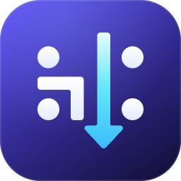
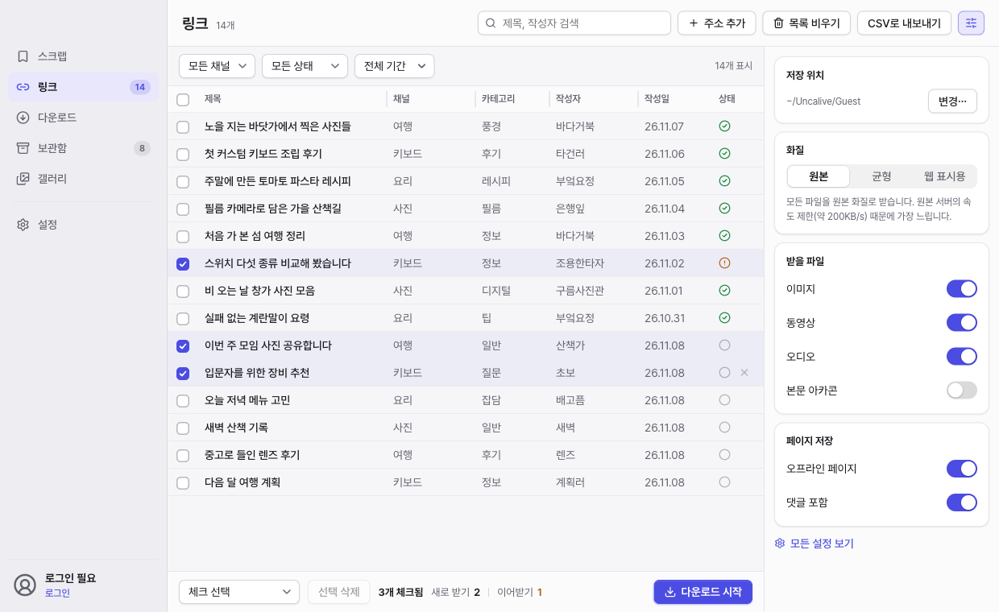
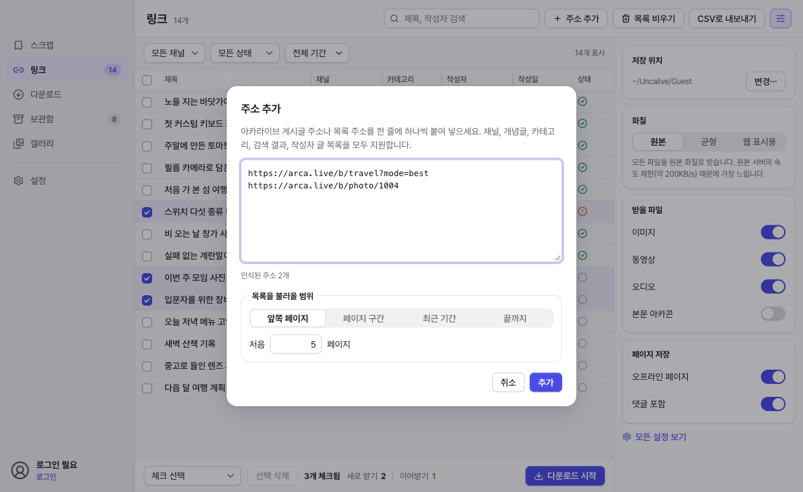
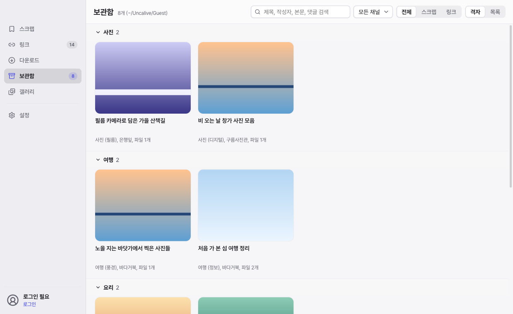
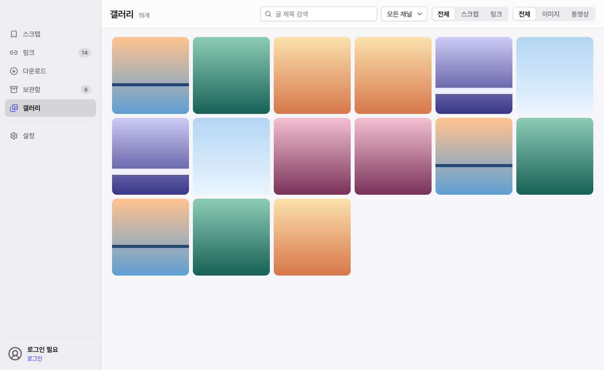

<p align="center">
  
</p>

<h1 align="center">언카라이브 (Uncalive)</h1>

<p align="center">
  아카라이브에서 스크랩한 글이나 지정한 주소의 게시글을 컴퓨터에 내려받아<br>
  인터넷 연결 없이도 언제든 열람하고 관리할 수 있는 데스크톱 아카이빙 프로그램입니다.
</p>

---

> [!CAUTION]
> **면책 조항 및 이용 시 주의사항**
> - **비공식 프로그램**: 언카라이브는 아카라이브 운영사와 무관한 비공식 프로그램입니다. 이 프로그램을 사용하여 발생하는 모든 문제(사이트 이용 제한, 계정 제재 등)에 대한 책임은 전적으로 사용자 본인에게 있습니다.
> - **서버 부하 주의**: 원본 서버에 무리를 주지 않도록 글 사이 대기 시간을 지나치게 줄이거나, 짧은 시간에 과도하게 많은 글을 반복해서 내려받지 마세요.
> - **개인 보관 목적**: 내려받은 게시글과 미디어의 권리는 각 작성자에게 있습니다. 저장한 파일은 개인 소장 용도로만 이용하고 무단으로 재배포하지 마세요.

## 화면 미리 보기

| 글 목록 및 다운로드 옵션 | 주소 추가 |
|---|---|
|  |  |
| **보관함** | **갤러리** |
|  |  |

*스크린샷에 포함된 게시글과 이미지는 설명을 위해 제작된 예시입니다.*

## 주요 기능

- **스크랩 및 링크 수집**: 내장 로그인 창으로 아카라이브에 로그인해 내 스크랩 목록을 불러오거나, 개별 게시글, 채널, 개념글, 카테고리, 검색 결과, 작성자 글 목록 주소를 입력해 원하는 범위만큼 글을 수집합니다.
- **완전한 오프라인 페이지 (`index.html`)**: 광고와 외부 스크립트를 모두 제거하고 내려받은 미디어 파일을 연결한 오프라인 전용 HTML을 생성합니다. 여러 페이지로 나뉜 댓글도 한 페이지로 합쳐 인터넷 없이 어느 브라우저에서나 열 수 있습니다.
- **화질 선택과 서버 부하 제어**: 원본, 균형(가로 1280px을 초과하는 이미지만 원본), 웹 표시용 중 화질을 선택할 수 있습니다. 원본 서버의 동시 연결 제한(2개)을 준수하며, 원본과 CDN 파일의 `ETag`가 같으면 빠른 CDN에서 내려받습니다.
- **안전한 이어받기와 실시간 대기열**: 다운로드 도중 중단하거나 일부 파일에 실패해도, 다시 시작하면 이미 받은 파일은 건너뛰고 빠진 파일만 이어서 받습니다. 다운로드가 진행 중일 때도 글을 대기열에 추가할 수 있습니다.
- **보관함 본문 검색**: 내려받은 글을 채널, 카테고리, 출처(`Scraps`, `Links`)별로 분류해 보여 주며, 제목과 작성자는 물론 본문과 댓글 내용까지 즉시 검색합니다.
- **미디어 갤러리**: 저장된 이미지와 동영상만 격자로 모아 보고 스페이스 바로 빠르게 훑어봅니다. 크게 보기 화면에서 확대, 회전(R), 클립보드 복사, 다른 폴더로 내보내기를 지원합니다.
- **새 스크랩 자동 확인**: 설정한 주기(1-24시간)마다 백그라운드에서 새로 스크랩한 글이 있는지 확인하고 자동으로 내려받습니다.
- **계정별 보관함 분리 및 운영체제 간 호환**: 닉네임이 아닌 로그인 아이디를 기준으로 계정별 보관함(비로그인 시 `Guest`)을 나누므로 닉네임을 바꿔도 섞이지 않습니다. 보관함 구조가 모든 운영체제에서 동일해 폴더를 다른 컴퓨터로 옮겨도 이어받기와 검색을 그대로 쓸 수 있습니다.

## 지원 환경 및 설치

[최신 릴리스](../../releases/latest)에서 사용 중인 운영체제와 아키텍처에 맞는 파일을 내려받으세요.

| 운영체제 | 지원 사양 | 설치 파일 |
|---|---|---|
| **macOS** | macOS 13 (Ventura) 이상, **Apple Silicon 전용** | `Uncalive-<버전>-macOS-arm64.dmg` (또는 `.zip`) |
| **Windows (x64)** | Windows 10 이상 (64비트 인텔/AMD) | `Uncalive-<버전>-Windows-x64-Setup.exe` (또는 `-Portable.zip`) |
| **Windows (ARM)** | Windows 11 이상 (ARM64) | `Uncalive-<버전>-Windows-arm64-Setup.exe` (또는 `-Portable.zip`) |
| **Linux (x64)** | 64비트 x86_64, glibc 2.25 이상 (시험판) | `Uncalive-<버전>-Linux-x86_64.AppImage` |
| **Linux (ARM)** | 64비트 ARM64, glibc 2.25 이상 (시험판) | `Uncalive-<버전>-Linux-arm64.AppImage` |

### macOS

1. 내려받은 `.dmg` 파일을 열고 **언카라이브**(`Uncalive.app`)를 **응용 프로그램** 폴더로 끌어 놓습니다.
2. **"확인되지 않은 개발자" 또는 "손상되었기 때문에 열 수 없습니다" 경고가 뜰 때**: 별도의 Apple 공증을 거치지 않은 앱이므로 터미널에서 아래 명령어를 한 번 실행한 뒤 다시 여세요.

```bash
xattr -dr com.apple.quarantine /Applications/Uncalive.app
```

> **1.x 버전(macOS 전용) 사용자 안내**: 처음 실행할 때 기존 저장 위치, 다운로드 옵션, 자동 확인 설정을 자동으로 가져오며 기존 보관함도 그대로 유지됩니다. 로그인만 한 번 다시 진행하면 됩니다.

### Windows

1. `Setup.exe`를 실행해 설치하거나, 무설치 버전인 `-Portable.zip`의 압축을 풀고 `Uncalive.exe`를 실행합니다.
2. **"Windows의 PC 보호(SmartScreen)" 창이 뜰 때**: **추가 정보**를 누른 뒤 **실행**을 누르면 정상적으로 실행됩니다.

### Linux

내려받은 AppImage 파일에 실행 권한을 부여한 뒤 실행합니다.

```bash
chmod +x Uncalive-*.AppImage
./Uncalive-*.AppImage
```

- Ubuntu 22.04 이상에서 실행되지 않으면 `libfuse2`를 설치하세요 (`sudo apt install libfuse2`).
- Ubuntu 24.04 등에서 샌드박스 오류로 창이 열리지 않으면 `--no-sandbox` 옵션을 붙여 실행해 보세요.

## 사용 방법

1. **로그인**: 왼쪽 아래의 **로그인**을 눌러 아카라이브에 로그인합니다. 로그인이 완료되면 창이 자동으로 닫히고 스크랩 목록을 불러옵니다.
2. **다운로드할 글 체크**: **스크랩** 또는 **링크** 화면에서 채널, 상태, 기간, 검색어로 목록을 추린 뒤 받을 글의 체크 상자를 켭니다.
   - 표의 줄은 Finder나 파일 탐색기처럼 클릭, `⌘`(Windows/Linux는 `Ctrl`) 클릭, `Shift` 클릭, 마우스 드래그로 여러 개를 한꺼번에 선택할 수 있으며, 선택한 줄에서 **스페이스 바**를 누르면 일괄 체크하거나 해제합니다.
3. **옵션 설정 및 다운로드**: 오른쪽 옵션 패널(또는 **설정**)에서 저장 위치, 화질, 받을 파일 종류, 오프라인 페이지 생성 여부를 정한 뒤 **다운로드 시작**을 누릅니다.
4. **열람 및 관리**: **보관함**에서 글을 두 번 클릭하거나 **열기**를 누르면 기본 브라우저에서 오프라인 페이지(`index.html`)가 열립니다. **갤러리**에서는 받은 이미지와 동영상을 크게 보거나 다른 앱 및 폴더로 복사해 내보낼 수 있습니다.

### 주요 단축키

| macOS | Windows / Linux | 동작 |
|---|---|---|
| `⌘R` | `Ctrl+R` | 스크랩 목록 새로고침 |
| `⌘,` | `Ctrl+,` | 설정 열기 |
| `⌘1` - `⌘5` | `Ctrl+1` - `Ctrl+5` | 화면 전환 (스크랩, 링크, 다운로드, 보관함, 갤러리) |
| `⌘A` / `Esc` | `Ctrl+A` / `Esc` | 목록 전체 선택 / 선택 해제 |
| `스페이스 바` | `스페이스 바` | 선택한 글 일괄 체크 (글 목록) / 크게 보기 (갤러리) |
| `Delete` | `Delete` | 선택한 글 목록에서 삭제 (링크) / 휴지통으로 이동 (보관함) |
| `⌘Z` | `Ctrl+Z` | 링크 목록 삭제 실행 취소 |
| `⌘C` | `Ctrl+C` | 선택한 이미지 또는 파일 복사 (갤러리) |
| `↩` | `Enter` | 체크한 글 다운로드 시작 (글 목록) / 선택한 항목 열기 (보관함, 갤러리) |

## 개인정보 및 데이터 보호

- **비밀번호 미저장**: 로그인은 아카라이브 웹페이지에서 직접 진행되며, 언카라이브는 비밀번호를 읽거나 저장하지 않습니다. 계정별 보관함 폴더를 구분하기 위해 로그인 창에 입력한 아이디만 확인하며, 로그아웃 시 앱 내 브라우저의 아카라이브 세션 데이터를 즉시 삭제합니다.
- **제3자 추적 및 광고 차단**: 로그인 화면을 제외한 모든 페이지를 읽을 때 아카라이브와 Cloudflare 보안 확인 외의 외부 요청 및 광고 스크립트를 차단합니다.
- **로컬 보관함 구조**: 내려받은 파일과 진행 기록(`.uncalive/`)은 지정한 보관함 폴더(기본값: 홈 폴더 아래 `Uncalive`)에만 저장됩니다. 파일 탐색기에서 폴더를 직접 지우거나 휴지통에서 복원하면 보관함 목록에 자동으로 반영됩니다.

## 빌드 및 개발

Node.js 22 이상이 필요합니다. 자세한 아키텍처와 테스트 방법은 [DEVELOPMENT.md](DEVELOPMENT.md)를, 버전별 변경 내역은 [CHANGELOG.md](CHANGELOG.md)를 참고하세요.

```bash
npm ci
npm start
```

## 라이선스

- **언카라이브**는 [MIT 라이선스](LICENSE)로 배포됩니다. (`© 2026 Hishydrogen`)
- [Electron](https://www.electronjs.org/), [React](https://react.dev/), [cheerio](https://cheerio.js.org/), [Lucide](https://lucide.dev/) 아이콘 및 [Pretendard](https://github.com/orioncactus/pretendard) 글꼴을 사용합니다.
